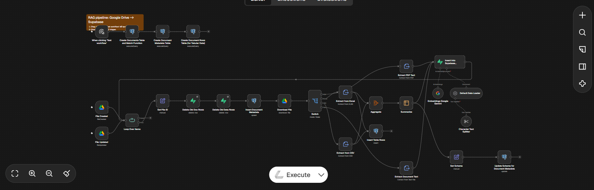
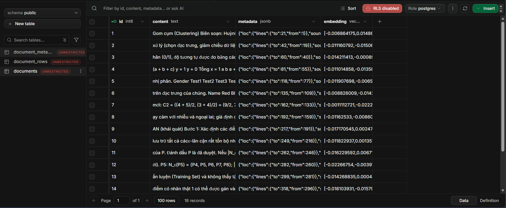
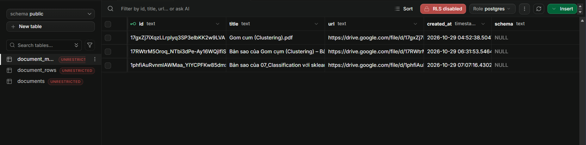
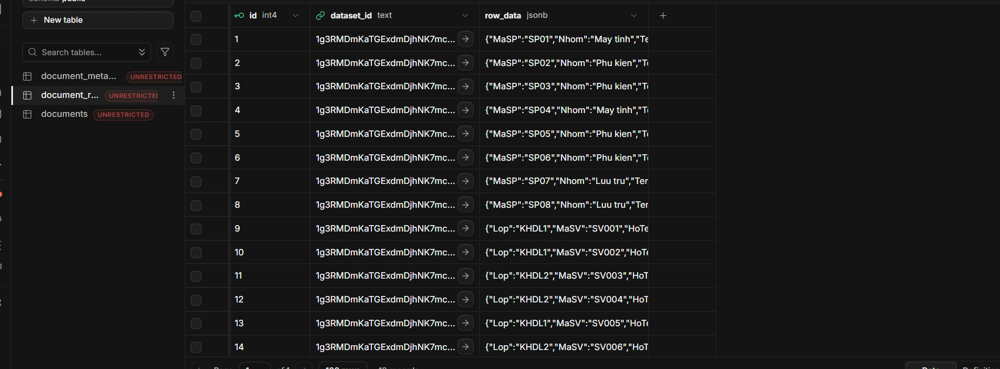

# 🧠 RAG Pipeline - n8n

Workflow nạp dữ liệu từ **Google Drive** → xử lý (PDF, Excel, CSV, Text...) → tạo **Embedding** → lưu vào **Supabase** để sử dụng cho hệ thống **RAG** (Retrieval-Augmented Generation).

---

## 📸 Giao diện Workflow

**Luồng xử lý chính:**
- Theo dõi file mới / file được cập nhật trên Google Drive
- Tải file về
- Phân loại loại file (PDF / Excel / CSV / Text)
- Trích xuất nội dung
- Tạo Embedding bằng **Google Gemini**
- Lưu vào các bảng trên **Supabase**

---

## 🗄️ Cấu trúc Database (Supabase)

### 1. Bảng `documents`

### 2. Bảng `document_metadata`

### 3. Bảng `document_rows`

---

## 🛠️ Công nghệ sử dụng

- **n8n** (Workflow Automation)
- **Google Drive** (Nguồn dữ liệu)
- **Google Gemini** (Embeddings)
- **Supabase** (PostgreSQL + Vector Store)
- **LangChain** nodes (Text Splitter, Document Loader...)

---

## 🚀 Cách sử dụng

### 1. Import Workflow
1. Mở n8n
2. Bấm **Import from File**
3. Chọn file `RAG nạp dl.json`

### 2. Cấu hình Credentials
Bạn cần thiết lập các credentials sau:

- Google Drive OAuth2
- Supabase API
- Google Gemini API (Embeddings)

### 3. Chạy Workflow
- Bấm **Execute Workflow** để chạy thủ công
- Hoặc để workflow tự chạy khi có file mới trên Google Drive

---

## 📁 Cấu trúc Repo
rag-n8n-workflow/
├── RAG nạp dl.json          # File workflow n8n
└── README.md

---

## 👨‍💻 Tác giả

- **GitHub:** [lhluann](https://github.com/lhluann)
- **Dự án:** RAG Pipeline với n8n + Supabase + Google Gemini

---

## 📝 Ghi chú

- Workflow hỗ trợ nhiều định dạng: PDF, Excel, CSV, Text
- Dữ liệu được chia nhỏ (Chunking) trước khi tạo embedding
- Phù hợp để xây dựng hệ thống hỏi đáp tài liệu (RAG Chatbot)
